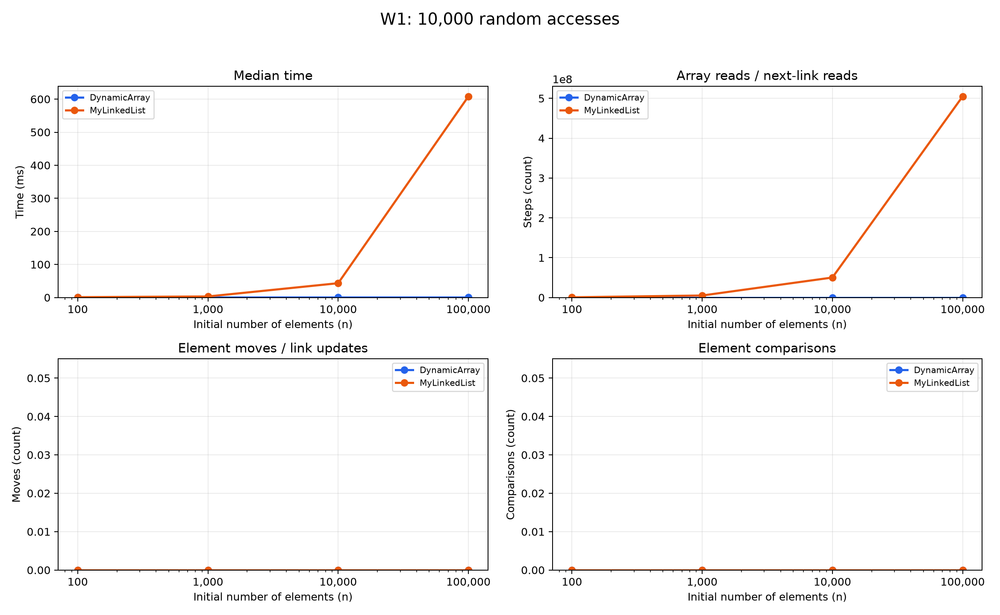
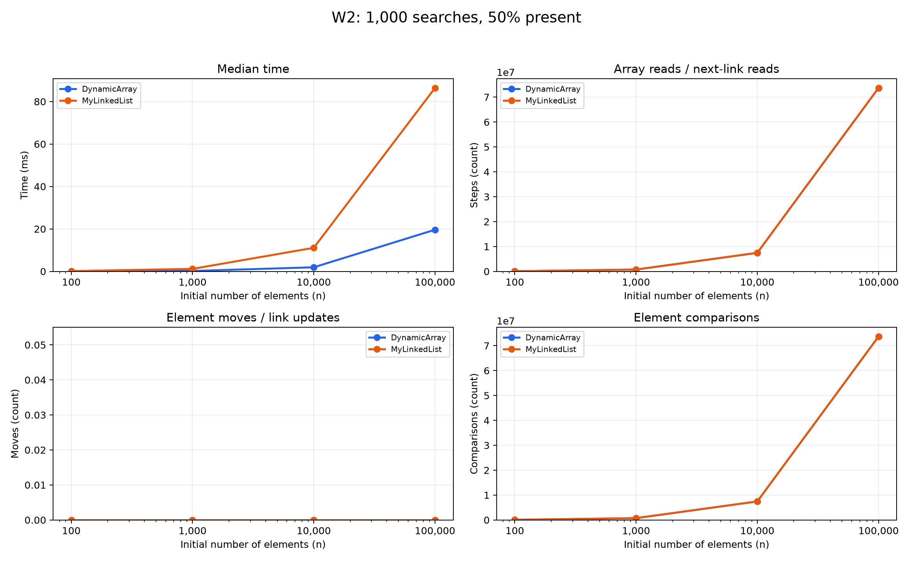
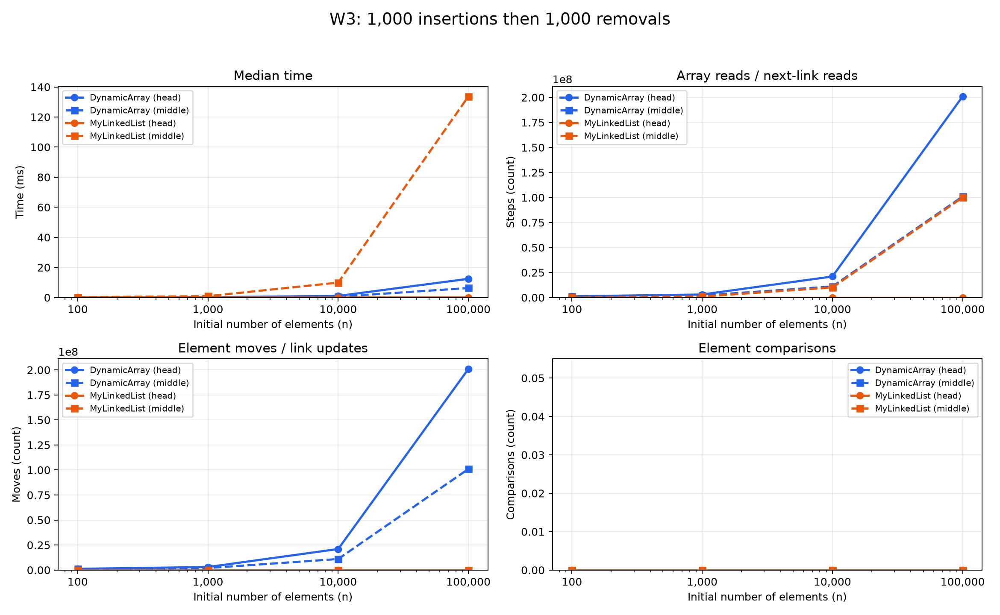
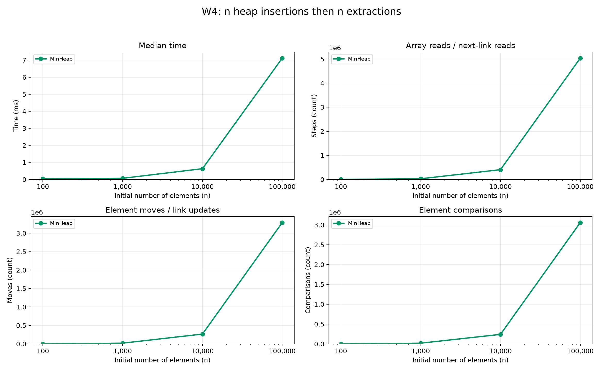

# Assignment 2: Data Structures

## 1. What I implemented

The project contains three data structures:

- **DynamicArray:** stores integers in an array. When the array is full, its capacity doubles.
- **MyLinkedList:** stores integers in nodes. Each node points to the next node. The list keeps references to its first and last nodes.
- **MinHeap:** stores integers in an array and keeps the smallest value at index 0.

All structures store primitive `int` values. DynamicArray and MyLinkedList implement the same `IntList` interface, so the benchmark can use the same methods for both.

## 2. How I measured performance

I tested sizes 100, 1,000, 10,000 and 100,000. I used `new Random(42)` to make the input repeatable. The array and list received the same values and queries.

Each case had two warm-up runs and five measured runs. I sorted the five times and saved the middle value, called the median.

The workloads were:

| Workload | Operations |
|---|---|
| W1 | 10,000 reads at random indices |
| W2 | 1,000 searches: 500 present values and 500 absent values |
| W3 head | 1,000 insertions, then 1,000 removals at index 0 |
| W3 middle | 1,000 insertions, then 1,000 removals at the original index n / 2 |
| W4 | Insert n values into the heap, then extract all n values |

For W1–W3, filling the structure was outside the measured time. Counters were reset after filling. For W4, both insertion and extraction were measured. Result checks were performed after stopping the timer.

The counters were updated inside the methods:

- **Steps:** reading an array cell or reading a `next` link in the list, including a link containing null.
- **Moves:** moving an existing array element or updating a list reference such as `head`, `tail` or `next`.
- **Comparisons:** comparing stored values. Index checks and loop conditions were not counted.

Copying an element during array growth counts as one step and one move. A heap swap counts as two moves. Writing a new value into an array is not counted as moving an existing element.

## 3. Complexity

Here, n means the number of stored elements.

- **Θ(1):** constant work.
- **Θ(n):** work grows linearly with n.
- **Θ(log n):** work grows with the height of a binary heap.
- **O:** an upper bound, which may not be tight.

For average indexed operations, I assume each valid index is equally likely. For a successful search, I assume the first matching position is equally likely to be anywhere in the structure.

Extra space below means temporary space used by an operation, not the space already occupied by the structure.

| Operation | Best | Average | Worst | Extra space, worst case | Reason |
|---|---|---|---|---|---|
| Array `add(x)` | Θ(1) | O(n) per call; Θ(1) amortized | Θ(n) | Θ(n) | Usually writes one value; growth copies all values. |
| Array `add(i,x)` | Θ(1) | Θ(n) | Θ(n) | Θ(n) | Shifts values and may grow the array. |
| Array `remove(i)` | Θ(1) | Θ(n) | Θ(n) | Θ(1) | Shifts values after the removed position. |
| Array `get(i)` | Θ(1) | Θ(1) | Θ(1) | Θ(1) | Reads one cell directly. |
| Array `contains(x)` | Θ(1) | Θ(n) | Θ(n) | Θ(1) | Checks values until a match is found or the array ends. |
| List `add(x)` | Θ(1) | Θ(1) | Θ(1) | Θ(1) | Uses the tail reference. |
| List `add(i,x)` | Θ(1) | Θ(n) | Θ(n) | Θ(1) | Middle insertion requires finding the previous node. |
| List `remove(i)` | Θ(1) | Θ(n) | Θ(n) | Θ(1) | Except at the head, it must find the previous node. |
| List `get(i)` | Θ(1) | Θ(n) | Θ(n) | Θ(1) | Follows links from the head. |
| List `contains(x)` | Θ(1) | Θ(n) | Θ(n) | Θ(1) | Checks nodes one by one. |
| Heap `insert(x)` | Θ(1) | O(n), including possible growth | Θ(n) | Θ(n) | Moves upward in the heap and sometimes copies the array. |
| Heap `peekMin()` | Θ(1) | Θ(1) | Θ(1) | Θ(1) | Reads the root. |
| Heap `extractMin()` | Θ(1) | O(log n) | Θ(log n) | Θ(1) | Moves a value down through the heap. |

**Average and amortized costs are different.** Average cost depends on how inputs and capacity states are distributed. Amortized cost spreads expensive operations across a sequence of operations.

Because the frequency of full-array states is not specified, O(n) is a safe per-call average upper bound for growing insertions. Across a sequence of appends, DynamicArray has Θ(1) amortized cost per append. Heap insertion has O(log n) amortized cost. Without array growth, heap insertion takes at most O(log n).

All three structures use Θ(n) total storage for nonempty data. `size()` and `metrics()` take Θ(1). The test helper `hasHeapProperty()` takes Θ(n) in the worst case and uses Θ(1) extra space.

## 4. Loop invariant proofs

A loop invariant is a statement that stays true before every loop iteration.

### 4.1 Search: DynamicArray.contains

**Invariant:** Before checking index i, none of the elements before i equals the searched value.

**Initialization:** At the start, i is 0. No elements have been checked, so the statement is true.

**Maintenance:** The method checks `data[i]`. If it matches, the method correctly returns true. Otherwise, this element is also not a match, so the statement remains true when i increases.

**Termination:** The method either finds a match or reaches `i == size`. If it reaches the end, every stored element has been checked and none matches, so it returns false. The loop must finish because i increases on each iteration.

**Conclusion:** The method returns true exactly when the value exists in the array.

### 4.2 Shifting: DynamicArray.remove

Let k be the removed index and n the original size. The method saves the removed value before shifting.

**Invariant:** Before iteration i:

- Elements before k are unchanged.
- Positions from k to i−1 contain the original values from one position to their right.
- Positions from i to n−1 are still unchanged.

**Initialization:** At first, i equals k. No values have moved, so the statement is true.

**Maintenance:** The assignment `data[i] = data[i + 1]` moves the next original value one position left. The source has not been changed yet. After i increases, the statement is still true.

**Termination:** The loop stops when i reaches n−1. All required values have moved left. Decreasing size removes the last cell from the logical array. If the removed element was already last, no shifting is needed.

**Conclusion:** The method removes exactly the requested element, keeps the remaining elements in order and returns the saved value.

## 5. Results

Each figure shows time, steps, moves and comparisons. The n-axis uses a logarithmic scale. The other axes use linear scales.

The following times were measured at n = 100,000:

| Workload | DynamicArray, ms | MyLinkedList, ms |
|---|---:|---:|
| W1: random access | 0.140709 | 608.189208 |
| W2: search | 19.617917 | 86.422666 |
| W3: head | 12.431917 | 0.006125 |
| W3: middle | 6.295500 | 133.717916 |

For W4, MinHeap took **7.117166 ms**. It recorded 5,033,591 steps, 3,287,427 moves and 3,059,125 comparisons.

## 6. Discussion

1. DynamicArray was much faster for random access because it reads the requested cell directly.
2. MyLinkedList had to start from the head and follow links to each requested index.
3. At n = 100,000, W1 used 10,000 array reads but 504,930,938 list-link reads.
4. Array values are stored next to each other in memory, which helps sequential reading.
5. A CPU cache line can hold several nearby array values, so one memory fetch can help with later reads.
6. List nodes are separate objects, and following their references is called pointer chasing.
7. Each node also needs an object header and a reference, and creating many nodes can increase garbage-collection work.
8. In W2, both structures made 73,682,044 value comparisons, but the array was faster.
9. This agrees with the expected benefit of array locality, although the benchmark did not measure cache misses directly.
10. The list made 500 fewer link reads than comparisons because each successful search returned before reading the next link.
11. The list was faster for head insertion and removal because it changed only a few references.
12. The array was faster for middle operations because the list had to find the middle again for every operation.
13. This list is useful for frequent head operations and tail appends, but removing its last node still requires traversal.
14. A min-heap is useful for processing the smallest-priority job first without keeping the entire array sorted.
15. Timings include counter updates and can change with JVM compilation, garbage collection and other activity, so these measurements are not universal speed ratios.